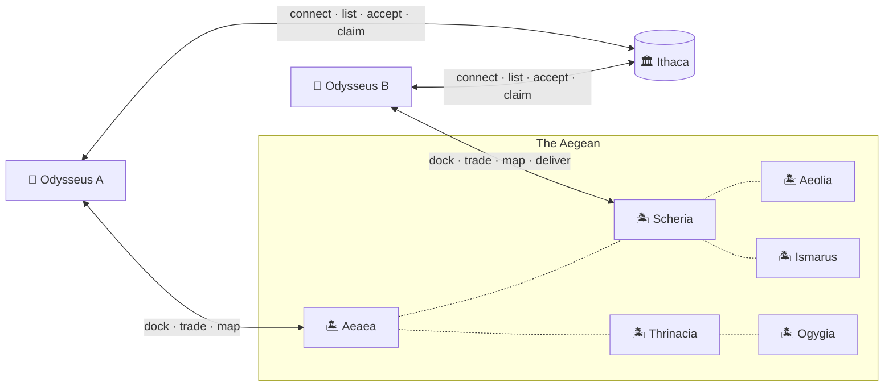
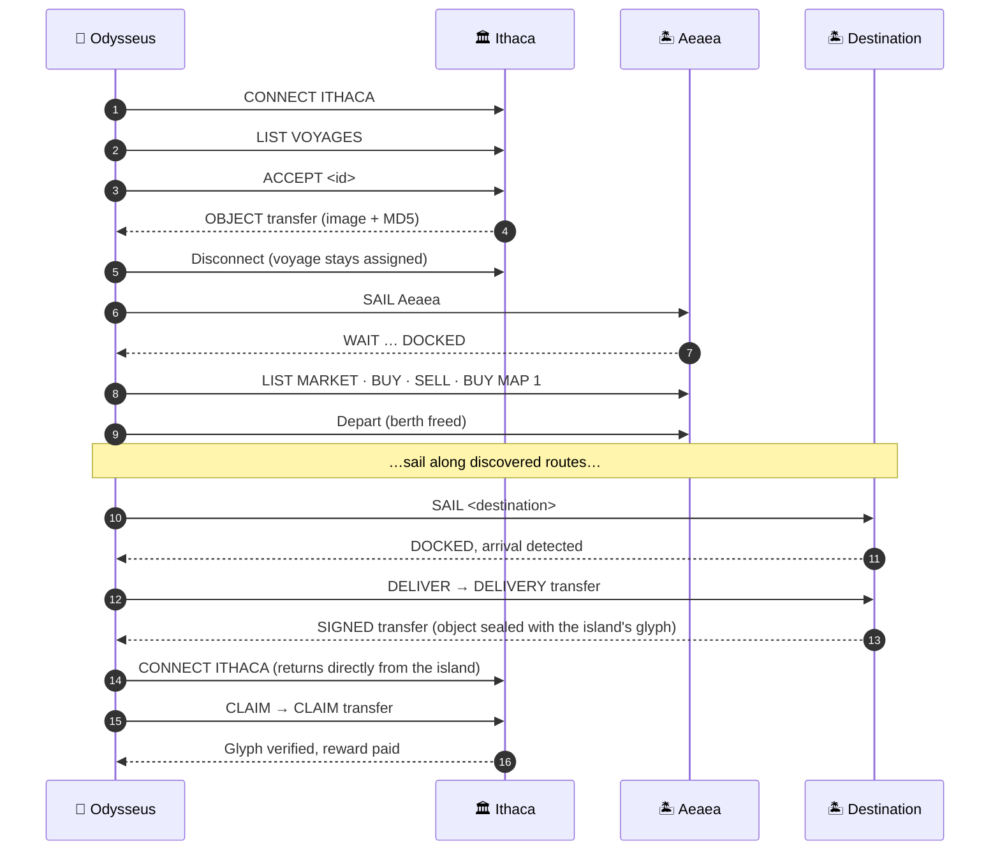

<div align="center">

# ⛵ The Nostos System

**A distributed maritime-transport network written in C**

*The Trojan War is over. The journey home will not be easy.*

Operating Systems · La Salle URL · 2026–2027

</div>

---

## Authors

| Name | Login |
| --- | --- |
| Axel Boleda | `a.boleda` |
| Guilherme Rodrigues | `gj.rodriguesferreira` |

---

## Table of Contents

- [Overview](#overview)
- [Project Status](#project-status)
- [1. Compile](#1-compile)
- [2. Execute](#2-execute)
- [3. Execute with Valgrind](#3-execute-with-valgrind)
- [4. Network and Ports](#4-network-and-ports)
- [Odysseus Commands](#odysseus-commands)
- [Mission Lifecycle](#mission-lifecycle)
- [Design](#design)
- [Files Written at Runtime](#files-written-at-runtime)
- [Testing](#testing)
- [Project Layout](#project-layout)
- [Configuration Files](#configuration-files)
- [Communication Protocol](#communication-protocol)

---

## Overview

The Nostos System is made up of three kinds of independent processes that talk to each other over TCP sockets, usually on different machines.

| Process | Role | Terminal |
| --- | --- | :---: |
| 🏛️ **Ithaca** | Central server. Holds the voyage list, assigns each voyage to a single ship, hands out the mission object and pays the reward once the sealed object comes back. | Log only |
| 🏝️ **Island** | One executable whose identity comes from its config file. It runs a port with limited berths and a FIFO waiting queue, a market backed by a binary stock file, sells its local map, and seals delivered objects with its glyph. | Log only |
| 🚢 **Odysseus** | The client (the ship). It accepts voyages, sails from island to island, trades, buys maps to find the route, delivers the object and claims the reward. | ✅ |

Odysseus talks to Ithaca while it is docked there, then drops that connection and talks to one island at a time. Ithaca and the islands never talk to each other.



Every voyage starts at **Aeaea**. Ithaca only tells the ship *where* to go, not *how* to get there. Each island knows only its direct neighbours, so the route has to be found by buying maps along the way. All routes are bidirectional.

---

## Project Status

All three phases are implemented, and every row of the four official test documents (Phase 1, Phase 2, Phase 3 and Global Testing) is covered by an automated scenario (see [Testing](#testing)).

| Phase | Content | Status |
| --- | --- | :---: |
| **1 · Inithaca** | Config loading, binary stock loading, Odysseus command terminal | ✅ Done |
| **2 · Aegean Ports** | Sockets, concurrent clients, exclusive voyages, berths + FIFO queue, trading, maps, food consumption | ✅ Done |
| **3 · Travels leave their mark** | File transfer with MD5 (`fork` + `exec md5sum`), worker threads synchronized with semaphores, glyph sealing, `DELIVER` / `CLAIM`, persistence between runs | ✅ Done |

---

## 1. Compile

From the root folder of the project:

```bash
make            # Compiles ithaca, island and odysseus
make rebuild    # Clean + build
make clean      # Removes binaries and build/
```

The binaries are placed in the project root and the object files in `build/`. The build uses `-Wall -Wextra -std=c99` and compiles with **zero warnings**. The provided SPHRAGIS library (`lib/sphragis/sphragis.o`) is linked automatically, along with `pthread`.

---

## 2. Execute

> [!IMPORTANT]
> Start **Ithaca** first, then the **Islands**, and then **Odysseus**.
> Each process runs in its own terminal, from the root folder of the project.

### 🏛️ Ithaca

```bash
./ithaca ithaca.dat voyages.dat
```

### 🏝️ Island

```bash
./island <island>.dat stocks/<Island>.db
```

```bash
# Example
./island aeaea.dat stocks/Aeaea.db
```

> [!NOTE]
> The stock file must be inside `stocks/` and have the same name as the island.

### 🚢 Odysseus

```bash
./odysseus <ship>.dat
```

```bash
# Examples
./odysseus odysseus.dat      # Polyphemus
./odysseus telemachus.dat
./odysseus penelope.dat
./odysseus eumaeus.dat
```

### Stopping

Press <kbd>Ctrl</kbd> + <kbd>C</kbd> to stop any process. Every process frees its memory, closes its sockets and files, and (on the servers) waits for running transfers, joins its worker threads and destroys its semaphores before exiting. A ship keeps its gold, cargo and active voyage for the next run.

---

## 3. Execute with Valgrind

Use the same arguments with `valgrind` in front:

```bash
valgrind --leak-check=full --show-leak-kinds=all --track-fds=yes ./ithaca ithaca.dat voyages.dat
```

```bash
valgrind --leak-check=full --show-leak-kinds=all --track-fds=yes ./island aeaea.dat stocks/Aeaea.db
```

```bash
valgrind --leak-check=full --show-leak-kinds=all --track-fds=yes ./odysseus odysseus.dat
```

Stop the process with <kbd>Ctrl</kbd> + <kbd>C</kbd> to see the Valgrind summary. After any run, `ipcs -s` should list no semaphores left behind.

---

## 4. Network and Ports

Each process is configured **only** through its `.dat` file (IP and port). Nothing is hardcoded, and no process assumes that it shares a machine with another (no `localhost` / `127.0.0.1`).

### Lab layout

The sample configs follow the Global Testing table. Every machine is in `172.16.214.0/24`.

| Machine | IP | Process | Port | Config |
| --- | --- | --- | :---: | --- |
| Montserrat | `172.16.214.21` | 🏛️ Ithaca | `8625` | `ithaca.dat` |
| | | 🏝️ Thrinacia (1 berth) | `8626` | `thrinacia.dat` |
| | | 🚢 Polyphemus | | `odysseus.dat` |
| | | 🚢 Eumaeus | | `eumaeus.dat` |
| Matagalls | `172.16.214.20` | 🏝️ Aeaea (1 berth) | `8625` | `aeaea.dat` |
| | | 🏝️ Aeolia (1 berth) | `8626` | `aeolia.dat` |
| | | 🚢 Telemachus | | `telemachus.dat` |
| Puigpedros | `172.16.214.18` | 🏝️ Scheria (2 berths) | `8625` | `scheria.dat` |
| | | 🏝️ Ogygia (1 berth) | `8626` | `ogygia.dat` |
| | | 🏝️ Ismarus (1 berth) | `8627` | `ismarus.dat` |
| | | 🚢 Penelope | | `penelope.dat` |

- **Direct routes:** Aeaea–Scheria, Aeaea–Thrinacia, Scheria–Aeolia, Scheria–Ismarus, Thrinacia–Ogygia.
- **Ithaca and Aeaea run on different machines**, as the spec requires.
- A port only has to be unique on its own machine, so servers on different machines reuse `8625`–`8627`.
- Each server listens on the IP and port in its own `.dat` file, so it must be started on the machine whose IP it lists (or use `0.0.0.0` to listen on all interfaces).
- Odysseus connects using plain IP addresses, not host names.
- Every process uses its own folder (line 2 of its config) and every island its own `stocks/<Island>.db`.

---

## Odysseus Commands

Commands are **case-insensitive** and are checked against the ship's current state before they run. For example, you can't trade unless you are docked, and you can't claim a reward before the object has been delivered.

| Command | Description |
| --- | --- |
| `CONNECT ITHACA` | Connect to Ithaca. From an island, the ship first leaves the island and returns directly to Ithaca. |
| `LIST VOYAGES` | Show the available voyages. Requires a connection to Ithaca and no active voyage. |
| `ACCEPT <id>` | Accept a voyage from the last `LIST VOYAGES`. Ithaca then sends the mission object, which the ship stores on board. |
| `SAIL <island>` | Sail to an island directly connected to the current location. From Ithaca, the only valid destination is Aeaea. `SAIL Ithaca` returns home from any island without connecting. |
| `MAP` | Draw the routes discovered so far (local, uses SPHRAGIS). |
| `LIST MARKET` | Show the market of the island where the ship is docked. |
| `BUY <product> <kg>` | Buy food while docked. `BUY MAP 1` buys the local map (50 gold, can be repeated). |
| `SELL <product> <kg>` | Sell food from the cargo while docked. |
| `STATUS` | Show gold, cargo, total provisions, location, active voyage and whether the object is on board or already sealed (local). |
| `DELIVER` | Deliver the object at the destination island. The island seals it with its glyph and sends it back. |
| `CLAIM` | Connected to Ithaca, present the sealed object and collect the reward. |

### ⚓ Waiting offshore

If a port is full, the ship waits in the island's FIFO queue. **For every full 5 seconds of waiting, the crew eats 7 kg of food.** Sailing itself costs no food. If provisions reach 0 before the ship docks, it is lost at sea, the voyage and its object are lost, and the next run starts again from the initial resources.

### Example session

```text
$ CONNECT ITHACA
Connected to Ithaca.

$ LIST VOYAGES
--- AVAILABLE VOYAGES ---
1. AeolusBagOfWinds     -> Scheria    [1150]
...
6. TridentOfPoseidon    -> Scheria    [1500]
...

$ ACCEPT 6
Voyage 6 accepted.
Destination: Scheria.
Object received correctly.

$ SAIL Aeaea
Leaving Ithaca...
Sailing to Aeaea...

$ BUY MAP 1
Bought the map of Aeaea for 50 gold.
New routes have been charted.

$ SAIL Scheria
Leaving Aeaea...
Sailing to Scheria...

$ DELIVER
Delivering TridentOfPoseidon to Scheria...
Object transferred correctly.
Scheria is stamping the object...
Stamped object received.
Delivery completed.
The mark of Scheria has been obtained.

$ CONNECT ITHACA
Returning directly to Ithaca...
Connected to Ithaca.

$ CLAIM
Presenting the stamped TridentOfPoseidon...
Object transferred correctly.
Glyph of Scheria verified.
Voyage 6 completed.
Reward received: 1500 gold.
```

---

## Mission Lifecycle



A voyage is **exclusive**: once assigned it never appears in another ship's list. If the ship is lost at sea, Ithaca marks the voyage as failed.

---

## Design

### Servers: one `select()` loop owns all shared state

`ithaca` and `island` each run one `select()` loop over the listening socket, every client socket and the worker pool's notification pipe, with no timeout, so the process sleeps in the kernel until something is ready.

Every change to shared state (voyage assignment and completion, berth count, queue order, stock, the client array) happens inside that loop. Each handler finishes before the next request is read, so **mutual exclusion comes from the loop itself**. For example, the `AVAILABLE` → `ASSIGNED` check-and-set in Ithaca can't race. A slow or idle client can't stall the server, because the server only reads from sockets that `select` reports as ready.

### File transfers: a worker pool synchronized with semaphores

Sending or receiving an image can take a while, so the servers hand it to a fixed pool of **4 worker threads** (`utils_pool`) with a job queue of 16 slots:

- The queue is a ring buffer of jobs guarded by two System V semaphores from the provided library: `tItems` counts pending jobs (idle workers sleep on it) and `tMutex` protects the ring.
- Submitting never blocks. If the queue is full, the client gets a "busy" error.
- Jobs are plain data with a type (`JOB_SEND_FILE`, `JOB_RECEIVE_FILE`, `JOB_SEAL_DELIVERY`, `JOB_VERIFY_CLAIM`); the worker dispatches them with a `switch`.
- While a job runs, the loop removes that client's socket from its `select` set, so only the worker touches it. When the job ends, the worker writes it to a pipe that the loop watches; the loop then puts the socket back and applies the result (voyage completed, reward paid, voyage freed again on failure).
- Workers block all signals, so <kbd>Ctrl</kbd>+<kbd>C</kbd> only reaches the main thread. On shutdown, queued jobs finish, workers are joined and the semaphores are destroyed, so `ipcs -s` stays empty.
- Every frame of a transfer has a 10-second read timeout, so a stalled peer can't hold a worker forever.

Odysseus has a single connection and one transfer at a time, so it transfers directly without threads.

### Sealing and verifying objects

- **Island (DELIVER):** receives the image, seals a copy with `SPHRAGIS_sign_with_glyph()` and sends the sealed copy back (`SIGNED`).
- **Ithaca (CLAIM):** checks that the file name matches the mission, that the image carries the destination's glyph (`SPHRAGIS_has_glyph()`), and that its MD5 equals Ithaca's own seal of the original object for that island. Sealing is deterministic, so this also rejects a sealed image of a different object. Only then is the voyage completed and the reward paid.
- MD5 sums are computed by running the system `md5sum` with `fork` + `pipe` + `exec` (no `system` / `popen`, no own MD5 implementation).

### Island berths and the FIFO queue

The queue is built into the client array rather than stored in a separate container:

```
NEW ──► DOCKED ──► LEFT
  └───► WAITING ──┘ (ticket = arrivalCounter++)
```

- **Arrival:** the ship docks if a berth is free. Otherwise it gets `WAIT` and a ticket number, and its socket stays open.
- **Berth freed:** a berth is freed on departure, on socket close, or when a client crashes. Each time, the waiting ship with the **smallest ticket** gets `DOCKED`.
- A ship that has already sent its departure is marked `LEFT`, so the later socket close doesn't free its berth a second time.

Every purchase and sale is written back to the island's `stock.db`, so the market survives a restart.

### Odysseus: waiting without busy-waiting

While anchored outside a full port, `waitingAtPort()` waits with `select()` on the island socket and a 5-second timeout:

| Event | Action |
| --- | --- |
| socket ready | read the frame; `DOCKED` ends the wait immediately |
| timeout | eat 7 kg, print the ration, reset the timer; at 0 kg the ship is lost |
| <kbd>Ctrl</kbd>+<kbd>C</kbd> | the quit flag is set, so leave cleanly |

SIGINT is installed with `signal()`, and its handler only sets a `sig_atomic_t` quit flag (the only kind of global the project uses). Because `signal()` restarts `read()`, the terminal is also waited on with `select()` and a 200 ms timeout that re-checks the flag before reading a line.

### Odysseus persistence

The ship's state is saved in `<ship folder>/<Ship>.state`, a fixed-record binary file with a checksum written with `open` / `read` / `write` / `lseek`. It holds the gold, the cargo and the active voyage, and is saved after the object arrives, after the sealed object arrives and after the reward is paid. On the next run the ship restores it, including an accepted or already delivered voyage.

If the ship is lost at sea or stranded with no way to continue, its voyage files are deleted and the state is reset to the initial resources of the config file.

### Odysseus command pipeline

```
menu (readLine) ─► parse ─► validate (arity/syntax) ─► execute (state checks)
                                                         │
                                  handler / conversation ┘ ─► OdysseusStatus ─► message
```

Handlers return status values instead of printing errors themselves, so all error output comes from one place.

### Coding rules

- All screen and file I/O goes through `read` / `write`. `printf`, `scanf`, `puts`, `system`, `popen` and `stat` are not used.
- Formatted text is built with `asprintf`, written, then freed immediately.
- Every allocation is checked. Every error path and SIGINT closes sockets and files, frees memory and destroys semaphores.
- There are no magic numbers: protocol and flag values are `#define`s or `enum`s.
- No function pointers of our own: dispatch is always a `switch` over an `enum`.

---

## Files Written at Runtime

No temporary files are used. Every received image is kept under its final name, and a failed transfer deletes whatever it wrote.

| Process | Folder | Files |
| --- | --- | --- |
| 🚢 Odysseus | line 2 of its config (e.g. `./polyphemus_files`) | `<Ship>.object` (mission object), `<Ship>.signed` (sealed object), `<Ship>.state` (saved state) |
| 🏝️ Island | line 2 of its config (e.g. `./scheria_files`) | `<Ship>_<VoyageID>_<file>` (delivered image) and `<...>.signed` (its sealed copy) |
| 🏛️ Ithaca | objects folder (`./objects`) | `<Ship>_<VoyageID>_<file>` (accepted claim image, the proof of the voyage) |

The ship's and the island's folders are created on startup if they don't exist.

---

## Testing

`tests/load_test.py` starts Ithaca, the islands and several ships in a temporary folder and drives them through scripted scenarios: concurrent voyage races, berths and the FIFO queue, concurrent purchases, lost ships, full deliver-and-claim runs, corrupted transfers (bad MD5, bad size, flipped byte), claims with the wrong glyph or another ship's voyage, peers dying or SIGINT mid-transfer, restarts with persistence, Valgrind runs, and a static check of the source rules. The run fails if any System V semaphore is left behind.

```bash
make
python3 tests/load_test.py               # every scenario (a few minutes; Valgrind ones are slow)
python3 tests/load_test.py fullrun       # a single scenario
python3 tests/load_test.py fullrun --keep   # keep the temporary folder for inspection
```

`tests/lab/lab.sh` sets up and starts the Global Testing layout on the three lab machines, one folder per process:

```bash
tests/lab/lab.sh setup <montserrat_ip> <matagalls_ip> <puigpedros_ip>
tests/lab/lab.sh run ithaca              # VALGRIND=1 to run under valgrind
tests/lab/lab.sh check                   # leftover semaphores, zombies, open fds
```

---

## Project Layout

```
.
├── Makefile
├── src/
│   ├── odysseus/      # terminal, commands, cargo, map, persistence, protocol client
│   ├── ithaca/        # voyage server: assignment, objects, claim verification
│   ├── island/        # port, market, routes, delivery sealing
│   └── utils/         # shared: frame codec, I/O + sockets, MD5, file transfer,
│                      #         semaphore wrapper, worker pool
├── include/           # headers, same structure as src/
├── lib/sphragis/      # provided SPHRAGIS library and semaphore library
├── objects/           # mission object images handed out by Ithaca
├── stocks/            # binary island stock files (*.db)
├── tests/             # load_test.py and lab/lab.sh
├── *.dat              # sample configs (ithaca, islands, ships)
└── voyages.dat
```

The Makefile picks up new `.c` files automatically through wildcards.

---

## Configuration Files

<details>
<summary><b>🚢 &lt;ship&gt;.dat</b></summary>

```
<Name>
<Folder for its files>
<Ithaca IP> <Ithaca port>
Aeaea <IP> <port>
<Initial gold>
<Number of food items>
<Product> <kg>
...
```

```
Polyphemus
./polyphemus_files
172.16.214.21 8625
Aeaea 172.16.214.20 8625
250
2
Barley 40
DriedFigs 60
```

</details>

<details>
<summary><b>🏛️ ithaca.dat</b></summary>

```
Ithaca
./objects
172.16.214.21 8625
```

Lines: server name, folder with the object files, listen `<IP> <port>`.

</details>

<details>
<summary><b>📜 voyages.dat</b></summary>

Each line is `<OBJECT> <FILE> <DESTINATION> <REWARD>`. Ithaca assigns the voyage IDs itself, in file order.

```
AeolusBagOfWinds  objects/aeolus_bag_of_winds.png  Scheria   1150
LotusEaterLotus   objects/lotus_eater_lotus.png    Ogygia    500
OdysseusBow       objects/odysseus_bow.png         Ismarus   1050
```

</details>

<details>
<summary><b>🏝️ &lt;island&gt;.dat</b></summary>

```
Aeaea
./aeaea_files
172.16.214.20 8625
1
--- ROUTES ---
Scheria 172.16.214.18 8625
Thrinacia 172.16.214.21 8626
```

Lines: name, folder, listen `<IP> <port>`, port capacity, then the direct routes. Routes are **not trusted as written**: they are filtered with `SPHRAGIS_filter_island_configuration()` when the file is loaded, and only the routes that pass are ever sent to a ship.

</details>

<details>
<summary><b>📦 stocks/&lt;Island&gt;.db</b></summary>

A binary file of consecutive records, read until EOF:

| Field | Type | Meaning |
| --- | --- | --- |
| `name` | `char[100]` | Product name |
| `amount` | `int` | Stock in kg |
| `price` | `int` | Gold per kg |

Purchases and sales are written back to this file. Maps are not stored here and never run out.

</details>

---

## Communication Protocol

All messages are fixed-size **256-byte** frames. Each frame is serialized into a buffer and sent with a single `write`. The struct is never written directly to the socket.

```
┌──────────┬──────────┬─────────────┬────────────────────────┐
│   TYPE   │  FLAGS   │ DATA_LENGTH │          DATA          │
│  1 byte  │  1 byte  │   1 byte    │  253 bytes (0x00 pad)  │
└──────────┴──────────┴─────────────┴────────────────────────┘
```

**Flags:** bit 7 `RESPONSE` · bit 6 `ERROR` · bit 5 `BINARY`. Common values are `0x00` request · `0x80` OK · `0xC0` error · `0x20` / `0xA0` binary. Text fields inside `DATA` are separated with `&`. Once a frame starts arriving, the rest of it must arrive within 5 seconds or the client is dropped.

| Type | Message | Between |
| :---: | --- | --- |
| `0x01` | Connect | Odysseus ⇄ Ithaca |
| `0x02` | List voyages (one frame per voyage) | Odysseus ⇄ Ithaca |
| `0x03` | Accept voyage (followed by the OBJECT transfer) | Odysseus ⇄ Ithaca |
| `0x04` | Claim (followed by the CLAIM transfer) | Odysseus ⇄ Ithaca |
| `0x05` | Disconnect | Odysseus ⇄ Ithaca |
| `0x10` | Arrival → `WAIT` / `DOCKED` | Odysseus ⇄ Island |
| `0x11` | List market (one frame per product + map) | Odysseus ⇄ Island |
| `0x12` | Buy | Odysseus ⇄ Island |
| `0x13` | Sell | Odysseus ⇄ Island |
| `0x14` | Buy map (one frame per route) | Odysseus ⇄ Island |
| `0x15` | Deliver (DELIVERY transfer, then SIGNED transfer back) | Odysseus ⇄ Island |
| `0x16` | Departure | Odysseus ⇄ Island |
| `0x20` | File header: `<KIND>&<name>&<size>&<md5>` | any |
| `0x21` | File data (raw bytes, `BINARY` flag) | any |
| `0x22` | Ready to receive | any |
| `0x23` | Final ACK: `OK`, `SIZE_ERROR` or `MD5_ERROR` | any |
| `0x7F` | NACK (malformed frame) | any |

**File transfer:** the sender sends the header, the receiver answers *ready* (or an error), the file follows in ⌈size / 253⌉ data frames streamed straight from disk, and the receiver checks the size and the MD5 of what it stored before sending the final ACK. The transfer kind is one of `OBJECT` (Ithaca → ship), `DELIVERY` (ship → island), `SIGNED` (island → ship) and `CLAIM` (ship → Ithaca).

**SAIL sequence:** send `0x05` (from Ithaca) or `0x16` (from an island) → wait for the reply → close the socket → connect to the next island → send `0x10`.
