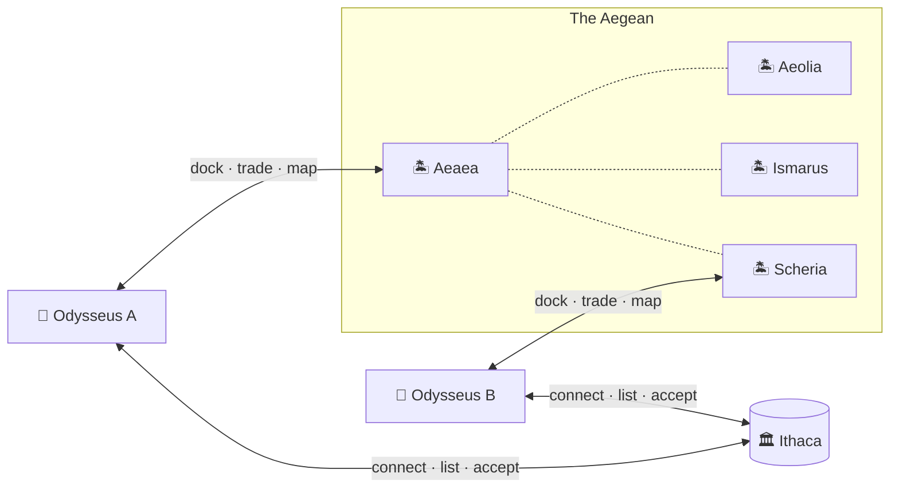
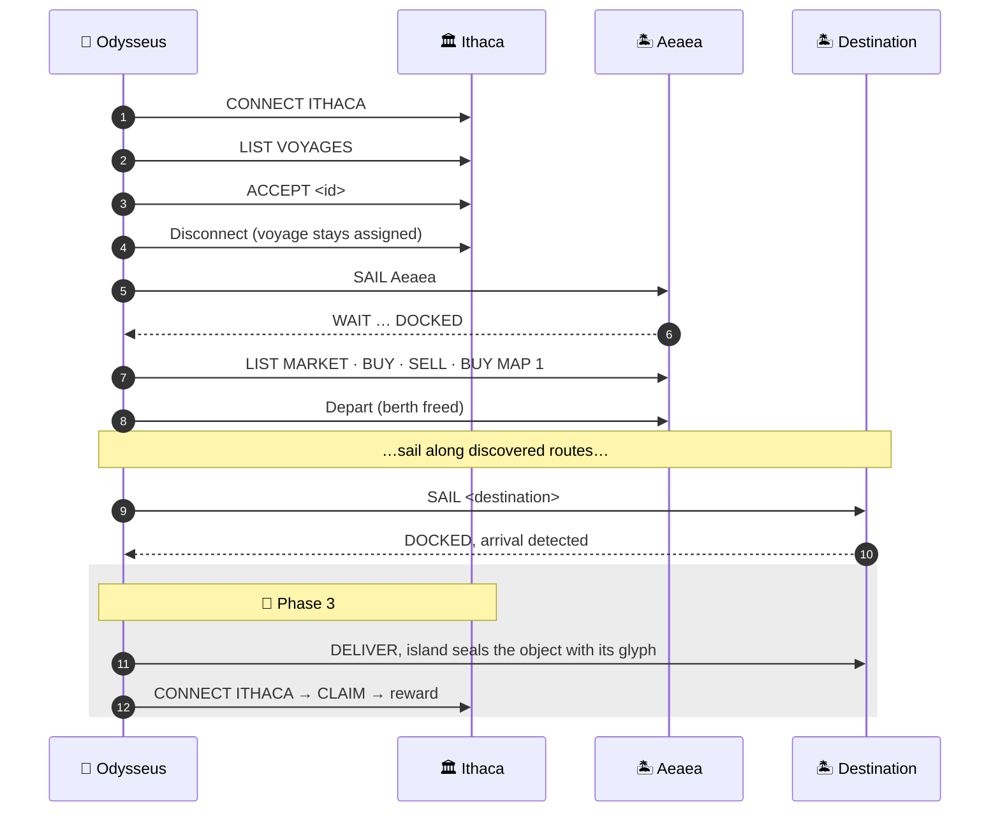

<div align="center">

# ⛵ The Nostos System

**A distributed maritime-transport network written in C**

*The Trojan War is over. The journey home will not be easy.*

Operating Systems · La Salle URL · 2026–2027

</div>

---

## Authors

| Name | Login |
| --- | --- |
| Axel Boleda | `a.boleda` |
| Guilherme Rodrigues | `gj.rodriguesferreira` |

---

## Table of Contents

- [Overview](#overview)
- [Project Status](#project-status)
- [1. Compile](#1-compile)
- [2. Execute](#2-execute)
- [3. Execute with Valgrind](#3-execute-with-valgrind)
- [4. Network and Ports](#4-network-and-ports)
- [Odysseus Commands](#odysseus-commands)
- [Mission Lifecycle](#mission-lifecycle)
- [Design](#design)
- [Project Layout](#project-layout)
- [Configuration Files](#configuration-files)
- [Communication Protocol](#communication-protocol)

---

## Overview

The Nostos System is made up of three kinds of independent processes that talk to each other over TCP sockets, usually on different machines.

| Process | Role | Terminal |
| --- | --- | :---: |
| 🏛️ **Ithaca** | Central server. Holds the voyage list and assigns each voyage to a single ship. | Log only |
| 🏝️ **Island** | One executable whose identity comes from its config file. It runs a port with limited berths and a FIFO waiting queue, a market backed by a binary stock file, and sells its local map. | Log only |
| 🚢 **Odysseus** | The client (the ship). It accepts voyages, sails from island to island, trades, and buys maps to find the route. | ✅ |

Odysseus talks to Ithaca while it is docked there, then drops that connection and talks to one island at a time. Ithaca and the islands never talk to each other.



Every voyage starts at **Aeaea**. Ithaca only tells the ship *where* to go, not *how* to get there. Each island knows only its direct neighbours, so the route has to be found by buying maps along the way. All routes are bidirectional.

---

## Project Status

| Phase | Content | Status |
| --- | --- | :---: |
| **1 · Inithaca** | Config loading, binary stock loading, Odysseus command terminal | ✅ Done |
| **2 · Aegean Ports** | Sockets, concurrent clients, exclusive voyages, berths + FIFO queue, trading, maps, food consumption | ✅ Done |
| **3 · Travels leave their mark** | Object transfer with MD5 (`fork` + `exec md5sum`), glyph sealing, `DELIVER` / `CLAIM`, persistence between runs | 🚧 Not implemented |

---

## 1. Compile

From the root folder of the project:

```bash
make            # Compiles ithaca, island and odysseus
make rebuild    # Clean + build
make clean      # Removes binaries and build/
```

The binaries are placed in the project root and the object files in `build/`. The build uses `-Wall -Wextra -std=c99` and must compile with **zero warnings**. The provided SPHRAGIS library (`lib/sphragis/sphragis.o`) is linked automatically.

---

## 2. Execute

> [!IMPORTANT]
> Start **Ithaca** first, then the **Islands**, and then **Odysseus**.
> Each process runs in its own terminal, from the root folder of the project.

### 🏛️ Ithaca

```bash
./ithaca ithaca.dat voyages.dat
```

### 🏝️ Island

```bash
./island <island>.dat stocks/<Island>.db
```

```bash
# Example
./island aeaea.dat stocks/Aeaea.db
```

> [!NOTE]
> The stock file must be inside `stocks/` and have the same name as the island config file.

### 🚢 Odysseus

```bash
./odysseus <odysseus>.dat
```

```bash
# Example
./odysseus odysseus.dat
```

### Stopping

Press <kbd>Ctrl</kbd> + <kbd>C</kbd> to stop any process.

---

## 3. Execute with Valgrind

Use the same arguments with `valgrind` in front:

```bash
valgrind --leak-check=full --show-leak-kinds=all --track-fds=yes ./ithaca ithaca.dat voyages.dat
```

```bash
valgrind --leak-check=full --show-leak-kinds=all --track-fds=yes ./island aeaea.dat stocks/Aeaea.db
```

```bash
valgrind --leak-check=full --show-leak-kinds=all --track-fds=yes ./odysseus odysseus.dat
```

Stop the process with <kbd>Ctrl</kbd> + <kbd>C</kbd> to see the Valgrind summary.

---

## 4. Network and Ports

Each process is configured **only** through its `.dat` file (IP and port). Nothing is hardcoded, and no process assumes that it shares a machine with another (no `localhost` / `127.0.0.1`).

### Lab layout

All machines are in `172.16.214.0/24` and use ports `8625–8629`.

| Machine | Process | Port |
| --- | --- | :---: |
| `172.16.214.18` | 🏛️ Ithaca | `8625` |
| `172.16.214.18` | 🏝️ Aeolia | `8628` |
| `172.16.214.20` | 🏝️ Aeaea | `8626` |
| `172.16.214.20` | 🏝️ Scheria | `8627` |
| `172.16.214.21` | 🏝️ Ismarus | `8629` |
| `172.16.214.21` | 🏝️ Thrinacia | `8625` |
| `172.16.214.21` | 🏝️ Ogygia | `8626` |

- **Ithaca and Aeaea run on different machines**, as the spec requires.
- There are 7 servers but only 5 ports. A port only has to be unique on its own machine, so **Thrinacia** and **Ogygia** reuse `8625` and `8626` on a machine where those ports are free.
- Each server listens on the IP and port in its own `.dat` file, so it must be started on the machine whose IP it lists (or use `0.0.0.0` to listen on all interfaces).
- Odysseus connects using plain IP addresses, not host names.

---

## Odysseus Commands

Commands are **case-insensitive** and are checked against the ship's current state before they run. For example, you can't trade unless you are docked, and you can't accept a voyage unless you are connected to Ithaca.

| Command | Description |
| --- | --- |
| `CONNECT ITHACA` | Connect to Ithaca (only if there is no active connection to Ithaca). |
| `LIST VOYAGES` | Show the available voyages. Requires a connection to Ithaca and no active voyage. |
| `ACCEPT <id>` | Accept a voyage from the last `LIST VOYAGES`. |
| `SAIL <island>` | Sail to an island directly connected to the current location. From Ithaca, the only valid destination is Aeaea. |
| `MAP` | Draw the routes discovered so far (local, uses SPHRAGIS). |
| `LIST MARKET` | Show the market of the island where the ship is docked. |
| `BUY <product> <kg>` | Buy food while docked. `BUY MAP 1` buys the local map (50 gold, can be repeated). |
| `SELL <product> <kg>` | Sell food from the cargo while docked. |
| `STATUS` | Show gold, cargo, total provisions, location and active voyage (local). |
| `DELIVER` | 🚧 *Phase 3:* deliver the object at the destination island. |
| `CLAIM` | 🚧 *Phase 3:* present the sealed object to Ithaca and collect the reward. |

### ⚓ Waiting offshore

If a port is full, the ship waits in the island's FIFO queue. **For every full 5 seconds of waiting, the crew eats 7 kg of food.** Sailing itself costs no food. If provisions reach 0 before the ship docks, it is lost at sea.

### Example session

```text
$ CONNECT ITHACA
Connected to Ithaca.

$ LIST VOYAGES
--- AVAILABLE VOYAGES ---
1. OdysseusBow        -> Ismarus  [1050]
2. TridentOfPoseidon  -> Scheria  [1500]

$ ACCEPT 2
Voyage 2 accepted.
Destination: Scheria.

$ SAIL Aeaea
Leaving Ithaca...
Sailing to Aeaea...

$ BUY MAP 1
Bought the map of Aeaea for 50 gold.
New routes have been charted.

$ SAIL Scheria
Leaving Aeaea...
Sailing to Scheria...
```

---

## Mission Lifecycle



---

## Design

### Servers: one `select()` loop, no locks

`ithaca` and `island` are both single-threaded. Each runs one `select()` loop over the listening socket and every client socket, with no timeout, so the process sleeps in the kernel until a socket is ready.

Every change to shared state (voyage assignment, berth count, queue order, stock) happens inside that loop. Each handler finishes before the next request is read, so **mutual exclusion comes from the loop itself**. For example, the `AVAILABLE` → `ASSIGNED` check-and-set in Ithaca can't race. A slow or idle client can't stall the server, because the server only reads from sockets that `select` reports as ready.

### Island berths and the FIFO queue

The queue is built into the client array rather than stored in a separate container:

```
NEW ──► DOCKED ──► LEFT
  └───► WAITING ──┘ (ticket = arrivalCounter++)
```

- **Arrival:** the ship docks if a berth is free. Otherwise it gets `WAIT` and a ticket number, and its socket stays open.
- **Berth freed:** a berth is freed on departure, on socket close, or when a client crashes. Each time, the waiting ship with the **smallest ticket** gets `DOCKED`.
- A ship that has already sent its departure is marked `LEFT`, so the later socket close doesn't free its berth a second time.

### Odysseus: waiting without busy-waiting

While anchored outside a full port, `waitingAtPort()` waits with `select()` on the island socket and a 5-second timeout:

| Event | Action |
| --- | --- |
| socket ready | read the frame; `DOCKED` ends the wait immediately |
| timeout | eat 7 kg, print the ration, reset the timer; at 0 kg the ship is lost |
| `EINTR` | <kbd>Ctrl</kbd>+<kbd>C</kbd> was pressed, so leave cleanly |

The SIGINT handler is installed with `sigaction` **without `SA_RESTART`**, so a blocked `read` / `select` returns `EINTR`. The only global is a `volatile sig_atomic_t` quit flag.

### Odysseus command pipeline

```
menu (readLine) ─► parse ─► validate (arity/syntax) ─► execute (state checks)
                                                         │
                                  handler / conversation ┘ ─► OdysseusStatus ─► message
```

Handlers return status values instead of printing errors themselves, so all error output comes from one place.

### Coding rules

- All screen and file I/O goes through `read` / `write`. `printf`, `scanf`, `puts`, `system`, `popen` and `stat` are not used.
- Formatted text is built with `asprintf`, written, then freed immediately.
- Every allocation is checked. Every error path and SIGINT closes sockets and files and frees memory.
- There are no magic numbers: protocol and flag values are `#define`s or `enum`s.

---

## Project Layout

```
.
├── Makefile
├── src/
│   ├── odysseus/      # terminal, commands, cargo, map, protocol client
│   ├── ithaca/        # voyage server
│   ├── island/        # port, market, routes server
│   └── utils/         # shared: frame codec, I/O + socket helpers
├── include/           # headers, same structure as src/
├── lib/sphragis/      # provided SPHRAGIS library (sphragis.o + sphragis.h)
├── stocks/            # binary island stock files (*.db)
├── *.dat              # sample configs (odysseus, ithaca, islands)
└── voyages.dat
```

The Makefile picks up new `.c` files automatically through wildcards.

---

## Configuration Files

<details>
<summary><b>🚢 odysseus.dat</b></summary>

```
<Name>
<Folder for its files>
<Ithaca IP> <Ithaca port>
Aeaea <IP> <port>
<Initial gold>
<Number of food items>
<Product> <kg>
...
```

```
Polyphemus
./polyphemus_files
172.16.214.18 8625
Aeaea 172.16.214.20 8626
250
2
Barley 40
DriedFigs 60
```

</details>

<details>
<summary><b>🏛️ ithaca.dat</b></summary>

```
Ithaca
./objects
172.16.214.18 8625
```

Lines: server name, folder with the object files, listen `<IP> <port>`.

</details>

<details>
<summary><b>📜 voyages.dat</b></summary>

Each line is `<OBJECT> <FILE> <DESTINATION> <REWARD>`. Ithaca assigns the voyage IDs itself.

```
OdysseusBow       ./obj/odysseus_bow.png        Ismarus 1050
TridentOfPoseidon ./obj/trident_of_poseidon.png Scheria 1500
CircesWand        ./obj/circes_wand.png         Ogygia  1000
```

</details>

<details>
<summary><b>🏝️ &lt;island&gt;.dat</b></summary>

```
Aeaea
./aeaea_files
172.16.214.20 8626
2
--- ROUTES ---
Aeolia  172.16.214.18 8628
Ismarus 172.16.214.21 8629
Scheria 172.16.214.20 8627
```

Lines: name, folder, listen `<IP> <port>`, port capacity, then the direct routes. Routes are **not trusted as written**: they are filtered with `SPHRAGIS_filter_island_configuration()` when the file is loaded, and only the routes that pass are ever sent to a ship.

</details>

<details>
<summary><b>📦 stocks/&lt;Island&gt;.db</b></summary>

A binary file of consecutive records, read until EOF:

| Field | Type | Meaning |
| --- | --- | --- |
| `name` | `char[100]` | Product name |
| `amount` | `int` | Stock in kg |
| `price` | `int` | Gold per kg |

Purchases and sales are written back to this file. Maps are not stored here and never run out.

</details>

---

## Communication Protocol

All messages are fixed-size **256-byte** frames. Each frame is serialized into a buffer and sent with a single `write`. The struct is never written directly to the socket.

```
┌──────────┬──────────┬─────────────┬────────────────────────┐
│   TYPE   │  FLAGS   │ DATA_LENGTH │          DATA          │
│  1 byte  │  1 byte  │   1 byte    │  253 bytes (0x00 pad)  │
└──────────┴──────────┴─────────────┴────────────────────────┘
```

**Flags:** bit 7 `RESPONSE` · bit 6 `ERROR` · bit 5 `BINARY`. Common values are `0x00` request · `0x80` OK · `0xC0` error · `0x20` / `0xA0` binary. Text fields inside `DATA` are separated with `&`.

| Type | Message | Between |
| :---: | --- | --- |
| `0x01` | Connect | Odysseus ⇄ Ithaca |
| `0x02` | List voyages (one frame per voyage) | Odysseus ⇄ Ithaca |
| `0x03` | Accept voyage | Odysseus ⇄ Ithaca |
| `0x04` | Claim 🚧 | Odysseus ⇄ Ithaca |
| `0x05` | Disconnect | Odysseus ⇄ Ithaca |
| `0x10` | Arrival → `WAIT` / `DOCKED` | Odysseus ⇄ Island |
| `0x11` | List market (one frame per product + map) | Odysseus ⇄ Island |
| `0x12` | Buy | Odysseus ⇄ Island |
| `0x13` | Sell | Odysseus ⇄ Island |
| `0x14` | Buy map (one frame per route) | Odysseus ⇄ Island |
| `0x15` | Deliver 🚧 | Odysseus ⇄ Island |
| `0x16` | Departure | Odysseus ⇄ Island |
| `0x20`–`0x23` | File transfer: header · data · ready · ack 🚧 | any |
| `0x7F` | NACK (malformed frame) | any |

**SAIL sequence:** send `0x05` (from Ithaca) or `0x16` (from an island) → wait for the reply → close the socket → connect to the next island → send `0x10`.
